<h3><code>sannidhi@cloud ~ $ ./contributions.sh</code></h3>

  

<h3><code>sannidhi@cloud ~ $ whoami</code></h3>

<table>
  <tr>
    <td valign="top"></td>
    <td valign="top"></td>
  </tr>
</table>

 

# Hi, I'm Sannidhi Sriram 👋

### Cloud & DevOps Engineer · Final-Year CSE @ Lovely Professional University

I design and deploy cloud infrastructure — AWS, Azure, Terraform, Docker, Kubernetes — and build the CI/CD and GitOps pipelines that ship it. 4× Oracle Cloud Certified. Open to Cloud / DevOps / SRE roles.

 

---

## 🏗️ Featured DevOps & Cloud Infrastructure Projects

**[observability-fargate](https://github.com/SannidhiSriram-06/observability-fargate)**
Prometheus + Grafana observability stack on AWS ECS Fargate — zero EC2 instances. Prometheus scrapes infrastructure metrics, Grafana visualizes them across a live dashboard with a real-time alert rule on request-rate breach. Full stack — VPC, subnets, IGW, security groups, ECR, least-privilege IAM roles, CloudWatch logging — provisioned entirely via Terraform.
`AWS ECS Fargate · Terraform · Prometheus · Grafana · Docker`

**[self-healing-microservice](https://github.com/SannidhiSriram-06/self-healing-microservice)**
Four-layer self-healing system on AWS — application health checks, container-level restart, Auto Scaling Group instance replacement, and ALB traffic isolation. Multi-AZ VPC, Application Load Balancer, and Auto Scaling Group provisioned via Terraform. GitHub Actions CI integrates Snyk to block vulnerable dependencies and images before they ship.
`AWS EC2 & ALB · Terraform · Docker · GitHub Actions · Snyk`

**[cloud-support-ticket-simulation](https://github.com/SannidhiSriram-06/cloud-support-ticket-simulation)**
Hands-on simulation of an AWS Cloud Support Engineering workflow across two IAM personas. Diagnosed and resolved a live outage via SSM Session Manager and CloudWatch Logs Insights, and executed a point-in-time AWS Backup restore — surfacing and documenting a real snapshot-consistency gap rather than trusting a "completed" status blind.
`AWS Backup · SSM · Client VPN · CloudWatch Logs Insights · IaC`

**[ai-test-generator](https://github.com/SannidhiSriram-06/ai-test-generator)** + **[ai-pytest-generator-gitops](https://github.com/SannidhiSriram-06/ai-pytest-generator-gitops)**
End-to-end CI/CD → GitOps pipeline: Jenkins enforces a 70% test-coverage gate, builds and tags Docker images, and pushes to AWS ECR. A companion GitOps repo holds the Helm chart as pure deployment state — Jenkins updates `values.yaml`, ArgoCD reconciles the change to Kubernetes automatically. The FastAPI service it deploys uses Groq's LLM API to generate pytest suites from source code.
`Jenkins · Docker · Kubernetes · Helm · ArgoCD · AWS ECR`

**[Bookstore-Microservice-Architecture-on-AWS](https://github.com/SannidhiSriram-06/Bookstore-Microservice-Architecture-on-AWS)**
Cloud architecture case study translating a Node.js Express REST API into AWS-managed services — Lambda for compute, API Gateway for routing, MongoDB Atlas for storage — eliminating server management while staying on AWS's free tier.
`AWS Lambda · API Gateway · MongoDB Atlas · CloudWatch`

---

## 🤖 AI & Full-Stack Applications

**[PitchPulse](https://github.com/SannidhiSriram-06/PitchPulse)**
Full-stack B2B sales intelligence platform — React/Vite on Vercel, Flask backend on Render, CrewAI multi-agent orchestration via Groq. Three-agent pipeline researches a company, drafts sales talking points, and formats a structured brief in under a minute. Clerk JWT auth with JWKS key rotation, Supabase Postgres, Resend for scheduled email delivery.
`Flask · React · CrewAI · Supabase · Clerk Auth`

**[upi-anomaly-explainer](https://github.com/SannidhiSriram-06/upi-anomaly-explainer)**
Multi-agent fraud detection system for UPI transactions, containerized and deployed on Hugging Face Spaces. A rule-based heuristics layer pre-filters transactions before three sequential CrewAI agents — analyst, plain-English explainer, and adversarial red-teamer — assess and cross-challenge each flag.
`Docker · CrewAI · Groq LLM · Flask · Hugging Face Spaces`

**[AI-Patient-Triage-System-on-Azure](https://github.com/SannidhiSriram-06/AI-Patient-Triage-System-on-Azure-CSA-Case-Study-)**
Flask app on Azure App Service routing patient-reported symptoms to Azure OpenAI for triage classification, with every interaction persisted to Azure Table Storage for audit and traceability.
`Azure App Service · Azure OpenAI · Azure Table Storage`

**[Infosys_AI_KYC_Compliance](https://github.com/SannidhiSriram-06/Infosys_AI_KYC_Compliance)**
Full-stack KYC document verification platform for BFSI — document classification (TFLite CNN), OCR extraction (EasyOCR), structured parsing via Groq LLM, and fraud detection with Graph Neural Networks. React frontend on S3, Node.js API and Python ML service on separate EC2 instances. Built during my Infosys Springboard internship.
`AWS EC2 & S3 · Node.js · Flask · PyTorch · GNN`

**[MEAN_STACK_Ghosting_Tracker](https://github.com/SannidhiSriram-06/MEAN_STACK_Ghosting_Tracker)**
Serverless MEAN-stack job application tracker — Angular frontend, Express API, MongoDB — that detects recruiter "ghosting" via Vercel Cron scans and scores resume fit using Groq LLM calls. Clerk-authenticated, deployed serverlessly on Vercel.
`Angular · Express.js · MongoDB Atlas · Vercel Cron · Groq LLM`

---

## 💼 Experience

**AI Intern — Cloud Deployment Lead**, Infosys Springboard (Feb – Mar 2026)
Led cloud deployment for a 25-member cohort building a BFSI-sector AI KYC system under Agile methodology. Evaluated SageMaker, Lambda, and EC2 for the ML service, selecting EC2 for cost efficiency and deployment control. Managed Git workflow and access across the cohort.

## 🏆 Certifications

- **Oracle Cloud Infrastructure (2025):** DevOps Professional · Observability Professional · Multicloud Architect Professional · Generative AI Professional
- **Microsoft Certified:** Azure Fundamentals (AZ-900) · Azure AI Fundamentals (AI-900)
- **Top 500 Globally**, Oracle Race to Certification 2025

---

### 📊 GitHub Stats

  

**[LinkedIn](https://linkedin.com/in/sannidhi-sriram/) · [Portfolio](https://sannidhisriram-06.github.io/) · [Email](mailto:sannidhisriram8@gmail.com)**

