<div align="center">


<br/><br/>

<table>
  <tr>
    <td valign="middle"></td>
    <td valign="middle">

# Hi, I'm Sannidhi Sriram 👋


</td>
  </tr>
</table>

<details>
<summary><b>$ neofetch --full</b></summary>

<br/>


</details>

<br/>

[](https://linkedin.com/in/sannidhi-sriram/)
[](https://sannidhisriram-06.github.io/)
[](mailto:sannidhisriram8@gmail.com)

</div>

---

<div align="center">

### `$ cat intro.txt`


</div>

| | |
|---|---|
| **Role** | Cloud & DevOps Engineer |
| **Based in** | Hyderabad, India |
| **Studying** | Final-year CSE, Lovely Professional University |
| **Focus** | AWS, Azure, Terraform, Kubernetes, CI/CD and GitOps |
| **Status** | Open to Cloud / DevOps / SRE roles |

---

<div align="center">

### `$ ls ./stack`

</div>

| Cloud | Infrastructure as code | CI/CD and GitOps | Containers |
|---|---|---|---|
|  |  |  |  |
|  |  |  |  |
| | |  | |

<div align="center">


</div>

---

## 💼 Experience

```text
* 2026-02 → 2026-03   AI Intern — Cloud Deployment Lead
│  Infosys Springboard
│  ├─ Led cloud deployment for a 25-member cohort on a BFSI AI KYC system
│  ├─ Chose EC2 over SageMaker and Lambda for cost and deployment control
│  └─ Ran the Git workflow and repo access across the cohort
```

## 🏆 Certifications

- **Oracle Cloud Infrastructure (2025):** DevOps Professional · Observability Professional · Multicloud Architect Professional · Generative AI Professional
- **Microsoft Certified:** Azure Fundamentals (AZ-900) · Azure AI Fundamentals (AI-900)
- **Top 500 Globally**, Oracle Race to Certification 2025

---

<div align="center">

### `$ stats --year`



<br/><br/>


</div>

---

<div align="center">

```text
sannidhi@cloud ~ $ exit
```

[LinkedIn](https://linkedin.com/in/sannidhi-sriram/) · [Portfolio](https://sannidhisriram-06.github.io/) · [Email](mailto:sannidhisriram8@gmail.com)

</div>
